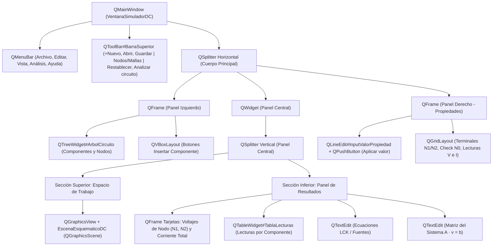

# Documentación Técnica y UX — Módulo 3: Interfaz Gráfica de Usuario en PySide6 (Qt)

**Responsabilidad del Integrante 3:** Diseño e implementación de la arquitectura visual en **PySide6**, experiencia de usuario (UX), lienzo vectorial interactivo (`QGraphicsView` / `QGraphicsScene`) y orquestación mediante el sistema de **Señales y Slots (Signals & Slots)** con el Módulo 1 (Modelo Eléctrico) y el Módulo 2 (Motor Numérico/Simbólico).

---

## 1. Jerarquía de Layouts y Widgets Principales de Qt

La aplicación sigue el patrón de diseño **Workbench de Tres Columnas con Panel Central Dividido**, encapsulado dentro de la clase [`VentanaSimuladorDC`](file:///c:/Users/Imprenta/Desktop/CALCULADORA/interfaz_pyside6/ventana_principal.py#L387-L840) (subclase de `QMainWindow`).

### Desglose Técnico por Zona

1. **Barra Superior (`QMenuBar` + `QToolBar`):**
   * Implementada en [`_construir_barra_herramientas`](file:///c:/Users/Imprenta/Desktop/CALCULADORA/interfaz_pyside6/ventana_principal.py#L411-L469).
   * Agrupa las acciones de gestión de archivo (`+ Nuevo`, `Abrir`, `Guardar`), un selector segmentado exclusivo construido con `QButtonGroup` (`Nodos` / `Mallas`), un espaciador elástico (`QSizePolicy.Expanding`) y los botones de acción global: `Restablecer` y el botón de llamado a la acción (CTA) destacado `Analizar circuito`.
2. **Divisor Principal (`QSplitter` Horizontal):**
   * Configurado en [`_construir_cuerpo_principal`](file:///c:/Users/Imprenta/Desktop/CALCULADORA/interfaz_pyside6/ventana_principal.py#L474-L499) con proporciones de estiramiento `setStretchFactor(1, 1)` para que el área central absorba el redimensionamiento de pantalla mientras los paneles laterales mantienen su ancho ergonómico.
3. **Panel Izquierdo — Navegación e Inserción (`QFrame` + `QVBoxLayout`):**
   * **Circuito Abierto (`QTreeWidget`):** Muestra jerárquicamente el proyecto activo (`circuito-ejemplo`), la rama `Componentes` (`V1`, `R1`, `R2`, `R3` con sus valores nominales alineados a la derecha) y la rama `Nodos` (`N1 · N2 · N0`).
   * **Insertar Componente (`QPushButton` estilizados):** Paleta vertical de herramientas para instanciar `Resistencia`, `Fuente de voltaje`, `Fuente de corriente`, `Conexión` y `Tierra`.
4. **Panel Central — Divisor Vertical (`QSplitter` Vertical):**
   * **Subpanel Superior (Espacio de Trabajo):** Contiene la cabecera informativa, el indicador de estado (`BadgeEstado: • Análisis completo`) y el lienzo interactivo basado en `QGraphicsView` y [`EscenaEsquematicoDC`](file:///c:/Users/Imprenta/Desktop/CALCULADORA/interfaz_pyside6/ventana_principal.py#L244-L380) (`QGraphicsScene`) con renderizado suavizado (`QPainter.Antialiasing`).
   * **Subpanel Inferior (Resultados):** Organizado mediante un `QVBoxLayout` que combina dos filas principales:
     * *Fila Superior:* A la izquierda, tarjetas métricas (`QFrame`) para los **Voltajes de Nodo** (`N1 respecto a N0 = 12 V`, `N2 respecto a N0 = 6,545 V`) y **Corriente total** (`54,545 mA`); a la derecha, un `QTableWidget` de 4 columnas (`Componente`, `Referencia`, `Voltaje`, `Corriente`).
     * *Fila Inferior:* Dos tarjetas simétricas con visores enriquecidos (`QTextEdit` en modo solo lectura con formato HTML matemático) para mostrar las **Ecuaciones** del método de nodos y la **Matriz del sistema** ($A \cdot v = b$).
5. **Panel Derecho — Inspector de Propiedades Contextual (`QFrame`):**
   * Implementado en [`_crear_panel_derecho`](file:///c:/Users/Imprenta/Desktop/CALCULADORA/interfaz_pyside6/ventana_principal.py#L728-L824). Muestra un badge con el identificador activo (`R1`), su categoría (`Resistencia`), un campo `QLineEdit` acompañado de su unidad física (`Ω` o `V`), el botón `Aplicar valor`, un `QGridLayout` con las terminales inicial/final, un `QCheckBox` de verificación de tierra (`Referencia N0 definida`) y las lecturas particulares del componente.

---

## 2. Flujo de Interacción del Usuario (UX)

### 2.1 Inserción y Exploración de Componentes
1. El usuario visualiza en el panel izquierdo la estructura completa del circuito en el árbol **CIRCUITO ABIERTO** y dispone en la mitad inferior de los botones de la sección **INSERTAR COMPONENTE**.
2. Al seleccionar una herramienta de inserción (como `Resistencia`), el botón adquiere el estilo visual activo (fondo verde suave `#E7F0E9`) indicando qué elemento se colocará en el lienzo.

### 2.2 Selección Sincronizada y Edición de Propiedades
La interfaz implementa **selección omnidireccional sincronizada** a través del método [`_sincronizar_seleccion`](file:///c:/Users/Imprenta/Desktop/CALCULADORA/interfaz_pyside6/ventana_principal.py#L830-L868):
1. El usuario puede hacer clic sobre un componente en cualquiera de las tres vistas:
   * Directamente sobre el símbolo gráfico en el lienzo (`QGraphicsScene`).
   * Sobre el ítem correspondiente en el árbol izquierdo (`QTreeWidget`).
   * Sobre la fila del componente en la tabla inferior (`QTableWidget`).
2. Inmediatamente:
   * El lienzo dibuja un recuadro translúcido de enfoque detrás del componente seleccionado (ej. `R1`).
   * El panel derecho (**PROPIEDADES**) actualiza su cabecera, muestra sus nodos de conexión (`Entre N1 y N2`), carga su valor actual (`100`) en el `QLineEdit` y despliega su voltaje (`5,455 V`) y corriente (`54,545 mA`).
3. Cuando el usuario modifica el número en el `QLineEdit` y pulsa **"Aplicar valor"**:
   * El slot [`_slot_aplicar_valor_propiedad`](file:///c:/Users/Imprenta/Desktop/CALCULADORA/interfaz_pyside6/ventana_principal.py#L880-L907) valida que el número sea estrictamente mayor que cero ($> 0$).
   * Se actualiza instantáneamente la etiqueta del componente en el `QTreeWidget` y en el esquemático del `QGraphicsScene`.
   * El badge superior cambia a `• Pendiente de analizar` para indicar al usuario que los resultados mostrados corresponden a una corrida previa.

### 2.3 Ejecución del Cálculo y Visualización de Resultados
Al presionar el botón destacado **"Analizar circuito"** en la barra superior:
1. Se ejecuta el slot [`_slot_analizar_circuito`](file:///c:/Users/Imprenta/Desktop/CALCULADORA/interfaz_pyside6/ventana_principal.py#L918-L953).
2. Se actualizan las tarjetas de **Voltajes de Nodo**, **Corriente Total**, las filas de la tabla **Lecturas por componente**, las cajas de **Ecuaciones** y **Matriz del sistema**, y las lecturas puntuales del panel derecho.
3. El indicador de estado del espacio de trabajo vuelve a `• Análisis completo`.

---

## 3. Arquitectura de Integración mediante Señales y Slots (Módulos 1, 2 y 3)

La comunicación entre la interfaz gráfica (**Módulo 3**) y los motores de backend (**Módulos 1 y 2**) está desacoplada siguiendo el patrón **Modelo-Vista-Controlador (MVC)** apoyado en `Signal` y `Slot` de PySide6:

| Evento en la Interfaz (Señal Qt) | Slot Receptor en `VentanaSimuladorDC` | Acción con Módulo 1 y Módulo 2 |
| :--- | :--- | :--- |
| `EscenaEsquematicoDC.componente_seleccionado(str)` | `_sincronizar_seleccion(id_comp)` | Consulta los metadatos del componente y refresca el Panel Derecho de Propiedades. |
| `QTreeWidget.itemClicked(QTreeWidgetItem, int)` | `_slot_item_arbol_clic` | Extrae el ID del elemento desde `Qt.UserRole` y sincroniza el lienzo y el inspector. |
| `QPushButton("Aplicar valor").clicked()` | `_slot_aplicar_valor_propiedad` | Valida la entrada del `QLineEdit`, actualiza el valor nominal del objeto [`Componente`](file:///c:/Users/Imprenta/Desktop/CALCULADORA/modulo1_modelo/elementos.py#L38-L77) en el Módulo 1 y redibuja la escena. |
| `QPushButton("Analizar circuito").clicked()` | `_slot_analizar_circuito` | 1. Instancia [`Circuito`](file:///c:/Users/Imprenta/Desktop/CALCULADORA/modulo1_modelo/elementos.py#L160-L250) y ejecuta [`AnalizadorNodos.construir_sistema()`](file:///c:/Users/Imprenta/Desktop/CALCULADORA/modulo1_modelo/analizador_nodos.py#L90-L195) (**Módulo 1**). 2. Pasa el sistema a [`MotorNumericoNumPy.resolver()`](file:///c:/Users/Imprenta/Desktop/CALCULADORA/modulo2_motor/resolvedor_numpy.py#L49-L107) y [`AnalizadorSimbolicoYResultados.calcular_magnitudes_circuito()`](file:///c:/Users/Imprenta/Desktop/CALCULADORA/modulo2_motor/simbolico_sympy.py#L123-L185) (**Módulo 2**). 3. Vuelca los resultados en las tarjetas, `QTableWidget` y visores de ecuaciones. |
| `QPushButton("Restablecer").clicked()` | `_slot_restablecer_valores` | Restaura los parámetros por defecto del circuito, reconstruye el árbol y dispara un nuevo análisis. |

