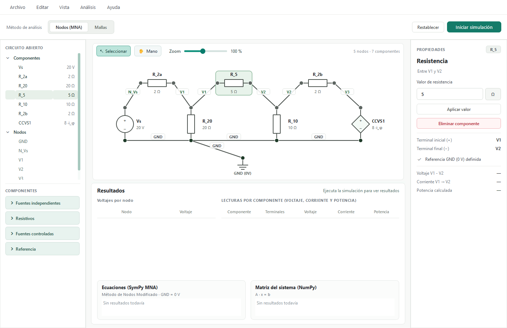
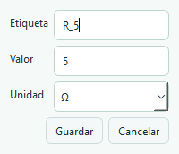
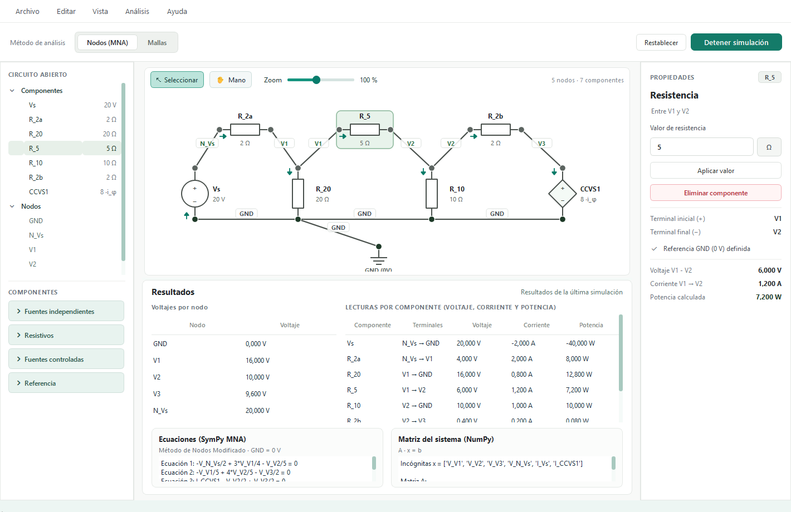
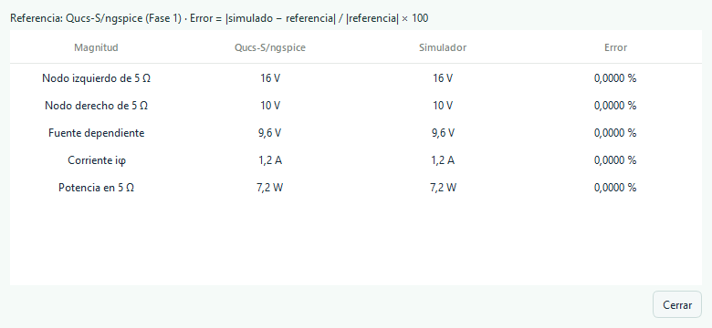
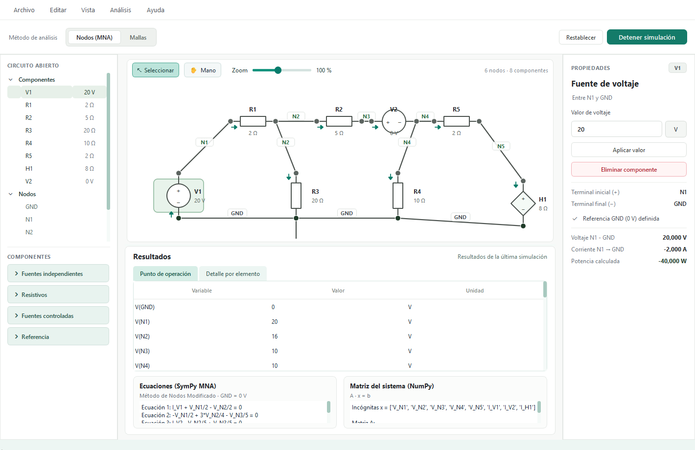
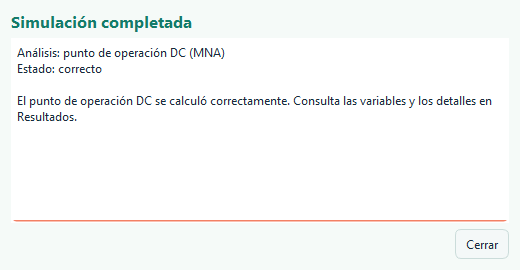
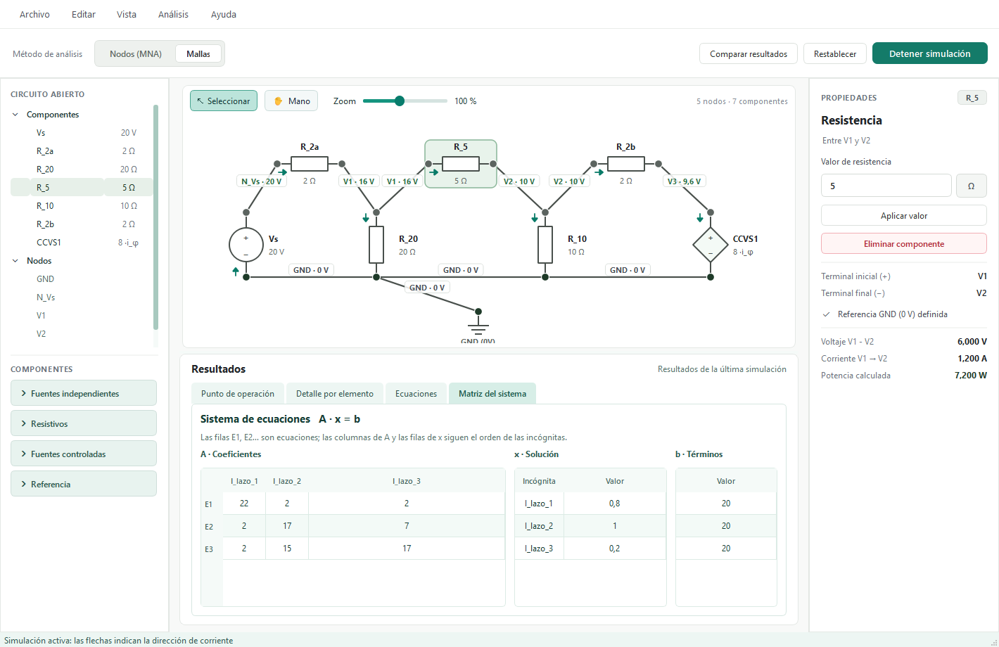
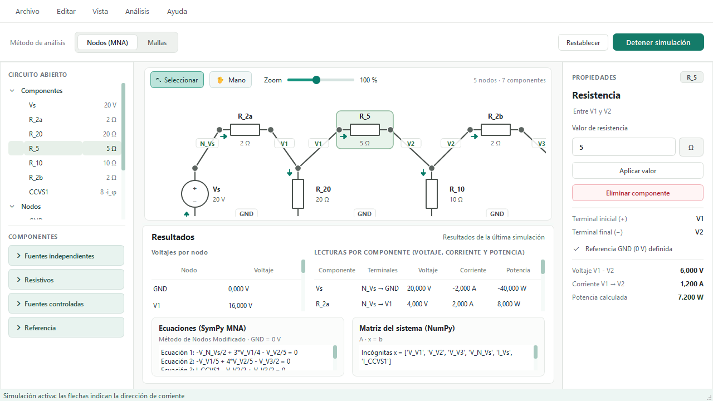
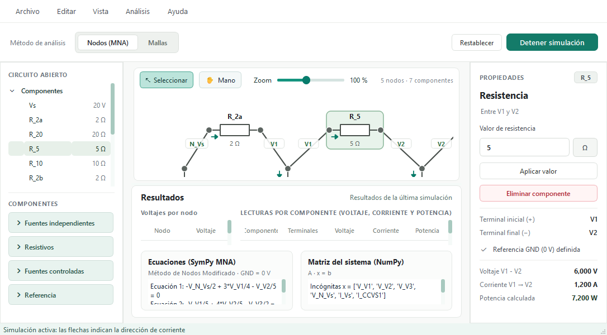

# Módulo 3 — Interfaz gráfica del simulador de circuitos DC

## Objetivo y alcance

La interfaz de escritorio permite construir y editar circuitos de corriente continua, ejecutar el análisis nodal modificado (MNA) y consultar los resultados calculados por los módulos de modelo y motor. Está implementada en Python con **PySide6**, los enlaces de Qt para Python. La versión revisada corresponde a la ventana **Simulador de Circuitos DC — Fase 3**.

La interfaz admite resistencias, fuentes independientes de voltaje y corriente, una fuente de voltaje controlada por corriente (CCVS) y tierra. Se puede elegir **Nodos (MNA)** o **Mallas**, una primera implementación basada en corrientes de lazos independientes.

## Vista general



Al iniciar, el lienzo carga el circuito de referencia de la fase 1. Los resultados y lecturas de propiedades aparecen vacíos hasta ejecutar la simulación. Las áreas principales son:

- **Menú Archivo:** Nuevo limpia el lienzo; Abrir admite archivos JSON del simulador y esquemas LTspice `.asc` compatibles. Guardar como crea archivos JSON del simulador.
- **Menú Editar:** Deshacer permite recuperar el estado anterior con **Ctrl+Z**; también se puede eliminar la selección.
- **Barra superior:** muestra el método de análisis, Restablecer —que carga el circuito de referencia— e Iniciar simulación / Detener simulación.
- **Comparar resultados:** aparece durante la simulación y compara el circuito de fase 1 con los valores documentados en Qucs-S/ngspice. El error se calcula como `|simulado − referencia| / |referencia| × 100`. Para una topología diferente no se genera una comparación automática; si se modificaron parámetros se muestra un aviso.
- **Panel izquierdo:** lista los componentes y nodos del circuito y muestra la paleta de componentes por categorías desplegables. Ambas secciones tienen desplazamiento vertical cuando hace falta.
- **Lienzo central:** contiene el esquema, los modos Seleccionar y Mano y un control de zoom. En modo Mano se desplaza el lienzo arrastrándolo en ambas direcciones.
- **Panel derecho:** muestra las propiedades del elemento seleccionado, permite cambiar su valor y eliminarlo, e indica si existe una referencia de tierra conectada. El indicador de tierra es informativo: se añade conectando un componente Tierra, no activando la casilla.
- **Resultados:** la pestaña Punto de operación presenta variables `V(nodo)`, `I(componente)` y `P(componente)` con sus unidades. Detalle por elemento muestra las tablas de nodos y componentes; las pestañas Ecuaciones y Matriz del sistema muestran el desarrollo matemático. Al detener la simulación o modificar el circuito se limpian los resultados.

## Construcción y edición de un circuito

1. En **Archivo → Nuevo**, limpiar el lienzo si se desea comenzar desde cero. Esta acción reemplaza el contenido actual; guardar primero si se necesita conservarlo.
2. Abrir una categoría de **Componentes** y arrastrar cada elemento al lienzo. En la paleta se pueden agregar resistencias, fuentes independientes, fuentes CCVS y tierra.
3. En el modo **Seleccionar**, mover los componentes y arrastrar desde un terminal hasta otro para crear un cable. Los terminales conectados forman un nodo. Se puede eliminar un cable o componente con la selección y la tecla Supr, o usando su menú contextual.
4. Hacer doble clic sobre un componente para modificar su etiqueta, valor y unidad. En una CCVS también se selecciona el componente cuya corriente sirve de control. Guardar aplica los cambios; Cancelar los descarta. El panel derecho también permite cambiar el valor del elemento seleccionado.
5. Conectar una tierra y asegurarse de que los terminales de los componentes eléctricos estén conectados. Pulsar **Iniciar simulación**. La ventana de estado informa si el cálculo terminó o describe el error. Para terminar la animación y limpiar los resultados, pulsar **Detener simulación**.
6. Usar **Archivo → Guardar como** para conservar el circuito y **Archivo → Abrir** para recuperarlo. Al abrirlo se debe ejecutar la simulación nuevamente para generar resultados.



El editor convierte las unidades seleccionadas a unidades base para los cálculos. Por ejemplo, 0,005 kΩ equivale a 5 Ω. Una resistencia debe ser mayor que cero. Las etiquetas deben ser únicas. Las modificaciones y la eliminación pueden revertirse con Ctrl+Z; el proyecto mantiene un historial limitado y no ofrece rehacer.

## Simulación y lectura de resultados



El resultado del circuito de referencia incluye cinco nodos: GND, N_Vs, V1, V2 y V3. Los valores observados son 0 V, 20 V, 16 V, 10 V y 9,6 V, respectivamente. La corriente por R_5 es 1,2 A. La fuente dependiente vale 8 × 1,2 A = 9,6 V. Las tablas se generan a partir del circuito resuelto y no dependen de que este tenga una cantidad fija de nodos.

Las flechas durante la simulación indican el sentido de las corrientes calculadas según los terminales de cada componente. Son una representación visual del resultado estacionario de corriente continua; no muestran una simulación transitoria ni el movimiento físico de cargas a escala. La potencia negativa de una fuente indica que entrega potencia según la convención de signos del motor.

Durante la simulación, las etiquetas de los cables muestran el potencial del nodo respecto a tierra. Al seleccionar un voltaje en resultados se resaltan los cables correspondientes; al seleccionar una corriente o potencia se resalta su componente. La fila seleccionada permanece destacada.



El panel inferior permite consultar el punto de operación, los resultados por componente, las ecuaciones generadas con SymPy y la matriz A, el vector b y la solución del sistema. En `I(componente)` se utiliza como referencia el sentido del terminal inicial al final; `P(componente)` aplica la convención pasiva. Las tablas y cajas de texto ofrecen desplazamiento vertical cuando el contenido excede el espacio visible.

## Importar un esquema de LTspice

En **Archivo → Abrir**, seleccionar un archivo `.asc`. La importación está limitada a resistencias estándar `res`/`res2`, fuentes independientes DC `voltage`/`current`, fuente CCVS `h` controlada por una fuente de voltaje y tierra. Se admiten valores numéricos con prefijos SPICE comunes y las orientaciones indicadas por el importador. Las fuentes con polaridad gráfica invertida, símbolos desconocidos, parámetros adicionales y directivas distintas de `.op` se rechazan con una descripción; no se ignoran para fabricar un resultado.

Los cables se reconstruyen como conexiones directas entre terminales: se conserva la conectividad admitida, pero no el trazado exacto ni la apariencia de LTspice. El archivo importado se puede guardar en JSON; el programa no exporta `.asc`. Es necesario revisar el esquema antes de simular.

Se comprobó el archivo de fase 1 proporcionado por el equipo. LTspice utiliza una fuente de 0 V como sensor de corriente: por ello aparecen dos nodos a 10 V, uno a cada lado del sensor. La corriente medida es 1,2 A y la resistencia de 5 Ω disipa 7,2 W.





## Arquitectura

- `VentanaSimuladorDC` (`QMainWindow`) organiza menús, barras, paneles y resultados y conecta los controles mediante señales y slots.
- `EscenaEsquematicoDC` (`QGraphicsScene`) administra componentes, terminales, cables y la conectividad; `VistaEsquematicoDC` (`QGraphicsView`) presenta el lienzo, selección, desplazamiento y zoom.
- `componentes_graficos.py` implementa la paleta arrastrable y los elementos gráficos. La posición de un componente actualiza las líneas conectadas.
- Al simular, la interfaz traduce la conectividad gráfica a `Circuito`, `AnalizadorNodos`, `MotorNumericoNumPy` y `AnalizadorSimbolicoYResultados`. Los módulos matemáticos forman y resuelven el sistema y devuelven el reporte a la interfaz.
- El temporizador Qt actualiza la posición visual de las flechas mientras la simulación está activa. La modificación del circuito detiene la animación e invalida los resultados mostrados.

El análisis de mallas construye una base de lazos independientes mediante un árbol generador. Las corrientes de lazo permiten obtener las corrientes de rama; las fuentes ideales de corriente añaden restricciones de corriente y voltajes desconocidos, mediante una formulación de supermalla generalizada. Una fuente CCVS utiliza la corriente de su rama de control. Las corrientes de lazo de la matriz dependen de la base generada y no tienen por qué coincidir con las corrientes de las caras visibles del dibujo. A partir de las tensiones de rama se recuperan los voltajes nodales para presentar los resultados habituales.

En la pestaña **Matriz del sistema**, las filas E1, E2… representan ecuaciones y las columnas de A siguen el orden de las incógnitas. Las tablas muestran A, la solución x y el vector b; se puede pasar el cursor sobre un valor para consultar más cifras. Si se elige Mallas, x contiene corrientes de lazo y, cuando corresponda, voltajes de fuentes de corriente; si se elige Nodos, contiene voltajes nodales y corrientes de fuentes de voltaje.



Código principal: [ventana_principal.py](../interfaz_pyside6/ventana_principal.py), [componentes_graficos.py](../interfaz_pyside6/componentes_graficos.py).

## Pruebas realizadas

Entorno de la revisión: Windows, Python 3.14.8, PySide6 6.12.0, NumPy 2.5.4 y SymPy 1.14.0. Las versiones son las observadas en este equipo; `requirements.txt` establece versiones mínimas, no versiones fijadas.

La suite se ejecuta desde la raíz del repositorio:

```powershell
.\.venv\Scripts\python.exe -m unittest discover -s tests -v
.\.venv\Scripts\python.exe -m unittest test_circuito_drag_drop
```

Si se utiliza otro entorno virtual, sustituir la ruta de Python por la correspondiente. Los casos añadidos en [test_flujo_interfaz.py](../tests/test_flujo_interfaz.py) y [test_nodos_interfaz.py](../tests/test_nodos_interfaz.py) cubren:

| Caso | Comprobación | Resultado |
|---|---|---|
| Construir un circuito sencillo | Eventos de soltar de Qt para fuente, resistencia y tierra; conexión de terminales con eventos de ratón; fuente de 12 V y resistencia de 10 Ω | Correcto: 1,2 A |
| Guardar y abrir | Archivo JSON temporal; se recuperan los tres cables y se vuelve a simular | Correcto |
| Editar y deshacer | Doble clic, cambio de etiqueta y de 0,005 kΩ a 5 Ω; actualización de referencia CCVS; Ctrl+Z con foco en el lienzo | Correcto |
| Seleccionar y mover | Selección de R_5, desplazamiento con el ratón, actualización del cable conectado y recuperación de la posición | Correcto |
| Validaciones | Terminal desconectado, resistencia de 0 Ω y ausencia de tierra; el indicador cambia al eliminar tierra | Correcto para estos casos |
| Resultados dinámicos | Sin resultados antes de simular; cinco nodos en el circuito original y seis en un circuito modificado; limpieza tras edición | Correcto |
| Navegación | Zoom al 150 % y desplazamiento con Mano en ambos ejes | Correcto en la prueba automatizada |
| Motor | Análisis nodal y lazos, fuentes de corriente y flotantes, sistema singular y CCVS de fase 1; contraste entre ambos métodos | Correcto para los casos incluidos |

Estas son pruebas automatizadas de Qt: la prueba de arrastrar envía eventos de soltar al lienzo y la de conexión envía eventos de ratón a la vista. No sustituyen una prueba manual completa del arrastre real de la paleta, menús contextuales, todos los formatos de archivo o todas las combinaciones de componentes. Las pruebas de interfaz se ejecutan con la plataforma Qt `offscreen`; aparecen advertencias de deprecación de constructores de eventos en PySide6 6.12, pero no afectan al resultado de estas pruebas.

### Tamaños de ventana observados

Las siguientes capturas se obtuvieron de la ventana de Qt en este equipo. Los tamaños son dimensiones de la ventana de la aplicación, no resoluciones físicas de pantalla.

| Tamaño solicitado | Tamaño obtenido | Observación |
|---|---|---|
| 1420 × 920 | 1420 × 920 | Paneles visibles; la etiqueta inferior de tierra queda parcialmente recortada con el zoom inicial. |
| 1280 × 720 | 1280 × 720 | Parte del esquema queda fuera de la vista inicial; las tablas muestran menos filas y requieren desplazamiento. |
| 1024 × 768 | 1086 × 768 | Qt mantiene un ancho mínimo aproximado de 1086 px; parte del circuito queda fuera de la vista inicial. |
| 900 × 600 | 1086 × 600 | No alcanza el ancho solicitado y la altura deja poco espacio visible para esquema y resultados. |





Para ver una parte del esquema que queda fuera del lienzo se puede reducir el zoom o desplazar la vista con Mano. Mejorar el ajuste inicial al tamaño disponible y la adaptación a ventanas menores de 1086 px sigue pendiente. Las capturas completas están en [capturas](capturas/).

## Limitaciones y trabajo pendiente

- Mallas es una primera implementación de lazos independientes para los componentes DC enumerados; requiere un circuito conectado a tierra y al menos un lazo cerrado. Aún debe ampliarse su validación con más topologías. No es un simulador general de componentes de CA o transitorios.
- La selección de tierra se realiza mediante un componente Tierra y conexiones; la casilla del panel derecho solo informa su estado.
- La documentación y pruebas de esta sección no constituyen una comparación con LTspice ni Qucs-S; esa comparación y sus errores porcentuales corresponden a la validación de resultados del proyecto.
- Antes de entregar el trabajo, completar una revisión manual de accesibilidad y de arrastre real en la computadora de presentación, generar las capturas finales que el equipo necesite y verificar el paquete en otro equipo.
